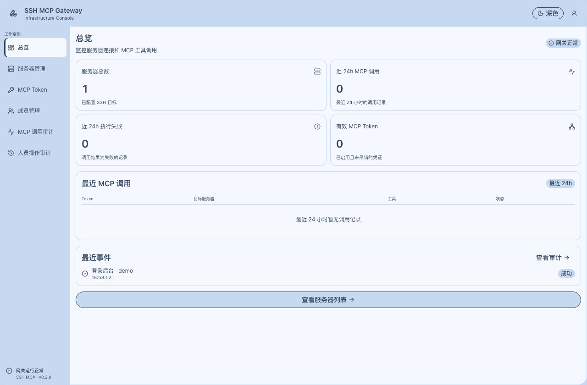

<div align="center">

# SSH MCP

**One workspace for SSH connections, AI tool calls, and operation history.**

[](https://hub.docker.com/r/lijx559/ssh-mcp)
[](docs/releases/2026-10-30-dockerhub.md)
[](https://gofastmcp.com)

[简体中文](README.md) · **English**

[Features](#features) · [Quick start](#quickstart) · [Docker](#deploy) · [MCP setup](#connect) · [Operations](#operations)

</div>

A self-hosted SSH gateway for individuals and teams. Configure Linux hosts once, grant Claude Code, Codex, and other MCP clients access by workspace, and trace both management actions and remote commands, file operations, and host checks.



<sub>Captured from the current build on 2026-11-17. Resources, members, and audit history are isolated demo data, with no production data or credentials. The console UI is in Chinese.</sub>

<a id="features"></a>

## Features

| Capability | Current behavior |
|---|---|
| Resources | Maintain host aliases, accounts, tags, and credentials; saved changes apply without a restart. |
| Workspace access | Assign a resource to multiple projects. Each Token belongs to exactly one workspace and can discover and operate only on its currently assigned resources. |
| MCP tools | 7 tools for commands, directories, text, transfers, and host checks. |
| Token lifecycle | Create, enable, disable, and confirm deletion. Newly issued Tokens support repeat copying plus Claude Code JSON and Codex TOML connection examples. |
| Token expiry | No expiry by default. Set, change, or clear an expiry; expired Tokens reject subsequent calls while preserving identity and history. |
| Members and sessions | Start with admin/admin; ordinary passwords require 6–1024 characters. Enabled members have equal access, the last enabled member is protected, and password changes or disabling/deletion revoke sessions. |
| Two audit trails | Trace management actions and MCP calls by credential, workspace, and actual target. Filters, details, CSV export, and 30-day default retention. |
| Desktop console | Ant Design 6, OPPO Sans 4.0, light/dark themes, a collapsible sidebar, and consistent pagination. |

<details>
<summary>Resources and workspace assignments</summary>


</details>

<details>
<summary>Token copying, controls, and expiry states</summary>


</details>

<details>
<summary>MCP call audit in the dark theme</summary>


</details>

<a id="quickstart"></a>

## Quick deployment with Docker

Requires Docker Engine or Docker Desktop. Pull the image and start it; Git, Python, Node.js, an `.env` file, and a pre-created configuration are not required. Choose either `docker run` or Compose below.

```bash
docker pull lijx559/ssh-mcp:0.3.0
docker run -d --name ssh-mcp \
  --restart unless-stopped \
  -p 127.0.0.1:8808:8808 \
  -v ssh-mcp-data:/data \
  lijx559/ssh-mcp:0.3.0
```

Open **http://127.0.0.1:8808/** and sign in with **`admin / admin`** on a new installation. The image creates a default configuration if missing and creates the default account only when the identity database has no users. Existing accounts, passwords, workspaces, Tokens, and audit data are preserved.

Docker creates the named volume automatically. It stores configuration, identities, the Token encryption key, and audit data under `/data`, surviving container replacement. When upgrading an existing deployment, retain its original volume or bind mount, UID/GID, and environment settings; update only the image to avoid switching to an empty volume.

<a id="deploy"></a>

## Use Docker Compose

Save this single `compose.yaml` file:

```yaml
name: ssh-mcp
services:
  ssh-mcp:
    image: lijx559/ssh-mcp:0.3.0
    container_name: ssh-mcp
    restart: unless-stopped
    ports:
      - "127.0.0.1:8808:8808"
    volumes:
      - runtime:/data
    stop_grace_period: 20s
volumes:
  runtime:
    name: ssh-mcp-data
```

```bash
docker compose pull
docker compose up -d
docker compose ps
```

Both methods use the same named volume and default container name. Stop and remove the previous container before switching methods, retaining the volume. Do not run two service instances against the same identity database.

### Sign in and connect resources

1. Sign in with `admin / admin` and change the password from the account menu if desired. Ordinary passwords require 6–1024 characters.
2. Create a project in Workspaces.
3. Add resources in Servers and assign one or more workspaces.
4. Create an MCP Token for that workspace; leave expiry empty for no expiry.
5. Copy the Token from the list or open its connection settings for Claude Code / Codex configuration.

The published host port is local-only by default. For direct LAN access, replace `127.0.0.1` in the port mapping with `0.0.0.0` and use `http://SERVER_IP:8808/`. Use HTTPS reverse proxying for public access. Inside the container, `127.0.0.1` refers to the container itself; use a container-reachable address for resources.

The image runs as UID/GID `1000:1000`; named volumes need no manual directory ownership setup. For a custom host bind mount, grant the container user read/write access. Resource credentials can be entered in the console. If using `${VARIABLE}` references, supply them through Compose `environment` / optional `env_file` or `docker run -e`.

<a id="connect"></a>

## Connect an MCP client

Create an MCP Token for the target workspace. Copy it again from the list or open its connection settings for Claude Code JSON / Codex TOML. These examples assume a local client:

Claude Code uses the project's `.mcp.json` file.

```json
{
  "mcpServers": {
    "ssh-mcp": {
      "type": "http",
      "url": "http://127.0.0.1:8808/mcp",
      "headers": {"Authorization": "Bearer <MCP_TOKEN>"}
    }
  }
}
```

Codex uses `~/.codex/config.toml` or a trusted project's `.codex/config.toml`.

```toml
[mcp_servers.ssh-mcp]
url = "http://127.0.0.1:8808/mcp"
http_headers = { Authorization = "Bearer <MCP_TOKEN>" }
```

This example assumes the client and gateway run on the same machine. Remote clients should use the gateway's actual HTTPS URL. Users of an existing deployment do not need a separate gateway process. Call `list_servers` first to discover resource names.

| Tool | Purpose |
|---|---|
| `list_servers` / `server_health` | Discover hosts and check host health. |
| `exec_command` | Run commands with timeouts and output limits. |
| `list_dir` / `read_file` | Browse directories and read UTF-8 text. |
| `upload_file` / `download_file` | Transfer files within configured size limits. |

Defaults: 2 MiB uploads, 10 MiB downloads, 1 MiB text reads, and 64 KiB each for command stdout/stderr. The remote SSH account determines actual permissions. Host keys are not verified unless `known_hosts` is configured. Timeouts do not guarantee termination of detached processes, and connection retries cannot guarantee exactly-once execution.

## People, credentials, and audit

- Web access uses username/password, HttpOnly session cookies, and CSRF protection. All enabled users have equal management access.
- The member list supports direct enable/disable controls and confirmed deletion. The last enabled account cannot be disabled or deleted. Deleting an account revokes its web sessions while preserving audit history and MCP tokens it created.
- The console manages all workspaces and resources. Each SSH device is created once and can belong to multiple workspaces. Unassigned resources are inaccessible to MCP tokens. A token belongs to exactly one workspace, fixed at creation. Removing a resource assignment blocks subsequent calls from that workspace, including established MCP sessions.
- A workspace with assigned resources or undeleted tokens, including disabled tokens, cannot be deleted. Changes to shared connection settings affect every workspace using the resource.
- MCP tokens are separate from users. Newly issued Tokens support copying from the list and generating Claude Code or Codex connection settings. Tokens are stored as verification hashes plus encrypted copies; ordinary list responses expose metadata only. Older hash-only tokens cannot be recovered and must be recreated to enable copying. Tokens authorize `/mcp`, not web login.
- Token creation and editing support an optional expiry in the browser time zone. Leave it empty for no expiry, or explicitly clear an existing limit. Expired Tokens reject subsequent MCP requests and calls, including new attempts after connection waits and retries. Staff may still copy or adjust the expiry; copying never restores access. Restarts preserve the limit, and deleted Tokens cannot be revived.
- Usernames, display names, and Token names allow up to 128 Unicode characters; Token descriptions allow up to 1000. Sign-in and editing share these limits.
- Restarts, upgrades, and container replacement preserve valid tokens. Creating a token or disabling its creator does not delete other tokens. Disabled tokens can be enabled again. Deleted tokens are invalidated immediately and removed from management lists while historical audit records remain available. Password changes and user disabling revoke that user's web sessions.
- Management audit records logins and configuration changes. MCP audit records token identity, actual host/port/remote account and command or path, outcome, and duration. Retention defaults to 30 days, with filters, details, and CSV export.
- Audit excludes credentials and complete file contents. Commands may contain business data; redaction of recognized credentials cannot detect every business secret. Local SQLite audit is neither tamper-proof nor a cross-system transaction guarantee.

<a id="operations"></a>

## Operations and upgrades

The default persistent volume is **`ssh-mcp-data`**, mounted at `/data`:

| Container path | Contents |
|---|---|
| `/data/config.yaml` | Service and resource configuration. |
| `/data/data/service.db` | Users, sessions, workspaces, Tokens, and encrypted copies. |
| `/data/data/service.token.key` | Token encryption key; back up and restore with the identity database. |
| `/data/audit/audit.db` | Management and MCP call audit. |
| `/data/keys/` | SSH keys, known_hosts, and related files. |

```bash
docker logs -f --tail=100 ssh-mcp
docker restart ssh-mcp
curl -fsS http://127.0.0.1:8808/healthz
```

For Compose, use `docker compose logs -f --tail=100`, `docker compose restart`, and `docker compose stop`. `docker compose down` retains named volumes; `down -v` deletes the data and is not an upgrade command.

### Backup and update

Stop the container and copy its entire data directory to the host, including SQLite files and the Token key:

```bash
umask 077
docker stop ssh-mcp
docker cp ssh-mcp:/data "./backup-ssh-mcp-$(date +%Y%m%d-%H%M%S)"
docker start ssh-mcp
```

To update with Compose, set `image` in `compose.yaml` to the new version, then run:

```bash
docker compose pull
docker compose up -d
```

For `docker run`, pull the new version, stop and remove the old container, and run again with the original ports and **the same data volume**. Upgrades and rollback retain matching configuration, identity database, key, and audit data. Legacy `auth.users` credentials are not imported automatically, and Tokens without a workspace are not granted access.

### Source and Python packages

Use source for development or custom builds; ordinary Docker deployment does not require these commands.

```bash
git clone --branch master https://github.com/Lixiuxiu559/ssh-mcp.git
cd ssh-mcp
uv sync --locked
uv run --locked ssh-mcp --init --config ./runtime/config.yaml
uv run --locked ssh-mcp --config ./runtime/config.yaml
```

The CLI supports `--config`, `--host`, `--port`, and `--data-dir`. Containers additionally use `--init-if-missing`, preserving existing configuration. Standalone `--init` creates configuration and exits. Configuration paths resolve against its parent directory; `--data-dir` resolves against the working directory and does not move existing data.

```bash
uv build
uvx --from ./dist/ssh_mcp-0.3.0-py3-none-any.whl ssh-mcp --init --config /absolute/path/ssh-mcp/config.yaml
uvx --from ./dist/ssh_mcp-0.3.0-py3-none-any.whl ssh-mcp --config /absolute/path/ssh-mcp/config.yaml
```

Local wheels/sdists include default configuration and console assets. Keep runtime data outside installation caches. uvx does not use the source `uv.lock`; package availability follows the release records.

<a id="development"></a>

## Development and project

The console follows the **Ant Design 6 console specification** with React 19, TypeScript, Vite, OPPO Sans 4.0, native light/dark themes, and consistent table pagination. Components and fonts are held within this service with no parent or sibling runtime imports. See the [development guide](CLAUDE.md).

This product uses OPPO Sans 4.0. Copyright 2024 Guangdong OPPO Mobile Telecommunications Corp., Ltd. See the [OPPO Sans Fonts License Agreement](webui/public/assets/fonts/OPPO-Sans-LICENSE.txt).

```bash
uv sync --locked
uv run --locked pytest
uv run --locked ruff check src tests
cd webui
npm ci
npm run build
```

Rebuild static assets after changing the frontend. To build a container from source, run from the repository root:

```bash
export SSHMCP_IMAGE=ssh-mcp:local
docker compose -f docker-compose.yml -f docker-compose.build.yml up -d --build
```

[Development guide](CLAUDE.md) · [Published digests](docs/releases/2026-10-30-dockerhub.md) · [Report an issue](https://github.com/Lixiuxiu559/ssh-mcp/issues)

This service is independently developed, released, and deployed. It shares conventions with the [MCP workspace](https://github.com/Lixiuxiu559/mcp) and has no runtime dependency on a parent directory or another MCP repository.
