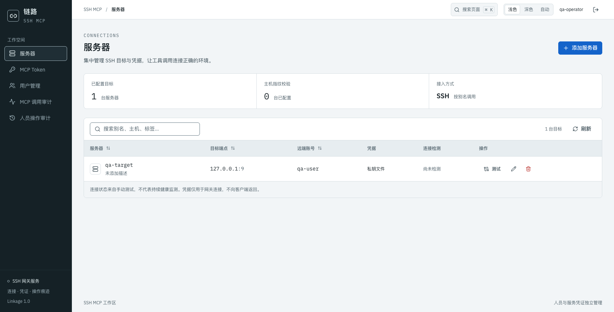

<div align="center">

# SSH MCP

**One workspace for SSH connections, AI tool calls, and operation history.**

[](https://hub.docker.com/r/lijx559/ssh-mcp)
[](docs/releases/2026-10-30-dockerhub.md)
[](https://gofastmcp.com)

[简体中文](README.md) · **English**

[Features](#features) · [Docker Compose](#deploy) · [MCP setup](#connect) · [Operations](#operations)

</div>

A self-hosted SSH gateway for individuals and teams. Manage Linux hosts and credentials centrally, and give MCP clients one endpoint for commands, file operations, and host health checks.



<sub>Screenshot from an isolated demo environment. No production resources or credentials are shown. The UI labels in this preview are in Chinese.</sub>

<a id="features"></a>

## Features

| Capability | What you can do |
|---|---|
| Host management | Maintain aliases, endpoints, accounts, tags, and credentials; web changes apply without a restart. |
| Remote operations | 7 MCP tools for commands, directories, text files, transfers, and host health. |
| Separate credentials | Username/password web access and independently managed MCP tokens. |
| Two audit trails | Track management actions and token calls against actual SSH targets; 30-day retention by default. |
| Unified workspace | Linkage UI, light/dark/system themes, command palette, and responsive layouts. |

<a id="deploy"></a>

## Deploy with Docker Compose

Requires Docker Engine (or Docker Desktop) and Docker Compose v2. No source checkout is needed; the image includes the complete web console. The deployment host must be able to reach your SSH hosts.

### 1. Prepare a deployment directory

The following commands target a regular Linux/macOS user. `.env` persists the image, port, and runtime UID/GID for future restarts.

```bash
mkdir -p ssh-mcp/runtime
cd ssh-mcp
umask 077
cat > .env <<EOF
COMPOSE_PROJECT_NAME=ssh-mcp
DOCKER_UID=$(id -u)
DOCKER_GID=$(id -g)
SSHMCP_IMAGE=lijx559/ssh-mcp:0.2.0
SSHMCP_BIND_ADDRESS=127.0.0.1
SSHMCP_PORT=8808
TZ=Asia/Shanghai
EOF
```

For deployment as root, set `DOCKER_UID` / `DOCKER_GID` in `.env` to a dedicated non-root account and give that account ownership of `runtime/`, for example `chown -R 1000:1000 runtime`. The image defaults to UID/GID `1000:1000`.

### 2. Save `docker-compose.yml`

```yaml
name: ssh-mcp
services:
  ssh-mcp:
    image: ${SSHMCP_IMAGE:-lijx559/ssh-mcp:0.2.0}
    restart: unless-stopped
    user: "${DOCKER_UID:-1000}:${DOCKER_GID:-1000}"
    ports:
      - "${SSHMCP_BIND_ADDRESS:-127.0.0.1}:${SSHMCP_PORT:-8808}:8808"
    volumes:
      - ./runtime:/data
    env_file:
      - .env
    environment:
      TZ: ${TZ:-Asia/Shanghai}
    stop_grace_period: 20s
```

Versioned tags and `latest` support **`linux/amd64` / `linux/arm64`**, selected automatically by Docker. Prefer a fixed version for deployments. You can also download [docker-compose.yml](docker-compose.yml) and [.env.example](.env.example) from this repository.

### 3. Initialize and start

```bash
docker compose pull
docker compose run --rm ssh-mcp ssh-mcp --init --config /data/config.yaml
docker compose up -d
docker compose ps
curl -fsS http://127.0.0.1:8808/healthz
```

Run `--init` only for the first deployment: it creates an empty configuration and never overwrites an existing file. Skip initialization when upgrading. Once health returns `{"ok":true}`, open **http://127.0.0.1:8808/**.

### 4. Create the first user

```bash
docker compose exec ssh-mcp cat /data/data/setup.key
```

Enter the one-time setup code in the web console and choose a username and separate password. The setup file is deleted after initialization. There is no default web account.

Add hosts and credentials in the Servers page, then create a client-specific token in MCP Token. Store private keys and `known_hosts` under `runtime/keys/`, referenced as `keys/...` in the configuration.

### Compose configuration

| Setting | Default | Purpose |
|---|---|---|
| `COMPOSE_PROJECT_NAME` | `ssh-mcp` | Use distinct project names, host ports, and runtime directories for multiple deployments. |
| `SSHMCP_IMAGE` | `lijx559/ssh-mcp:0.2.0` | Pinned image; change explicitly when upgrading. |
| `SSHMCP_BIND_ADDRESS` | `127.0.0.1` | Local access only; use `0.0.0.0` when direct LAN access is required. |
| `SSHMCP_PORT` | `8808` | Host port; the container continues to use `8808`. |
| `DOCKER_UID` / `DOCKER_GID` | `1000` / `1000` | Must have read/write access to `runtime/`. |
| `./runtime:/data` | Directory mount | Persists configuration, identities, tokens, and audit; mount the whole directory. |
| `env_file: .env` | `.env` | Supplies resource credentials to the container and values for Compose interpolation. |
| `TZ` | `Asia/Shanghai` | Container timezone; audit timestamps are stored in UTC. |

See [config.example.yaml](config.example.yaml). The live configuration is `runtime/config.yaml`; relative configuration paths resolve against its parent directory. `${VARIABLE}` reads the **container environment** and fails if missing. Add resource credentials to `.env`; web passwords and MCP tokens belong in their respective console pages. Web edits preserve environment references but discard YAML comments.

Inside a container, `127.0.0.1` refers to that container. For resources on the host, Docker Desktop supports `host.docker.internal`; Linux deployments can add `extra_hosts: ["host.docker.internal:host-gateway"]` when appropriate. Use a container-reachable address for remote resources.

<a id="connect"></a>

## Connect an MCP client

Create and save a token in the console, then add a configuration to an HTTP-capable MCP client:

```json
{
  "mcpServers": {
    "ssh-mcp": {
      "type": "http",
      "url": "http://127.0.0.1:8808/mcp",
      "headers": {"Authorization": "Bearer <MCP_TOKEN>"}
    }
  }
}
```

This example assumes the client and gateway run on the same machine. Remote clients should use the gateway's actual HTTPS URL. Users of an existing deployment do not need a separate gateway process. Call `list_servers` first to discover resource names.

| Tool | Purpose |
|---|---|
| `list_servers` / `server_health` | Discover hosts and check host health. |
| `exec_command` | Run commands with timeouts and output limits. |
| `list_dir` / `read_file` | Browse directories and read UTF-8 text. |
| `upload_file` / `download_file` | Transfer files within configured size limits. |

Defaults: 2 MiB uploads, 10 MiB downloads, 1 MiB text reads, and 64 KiB each for command stdout/stderr. The remote SSH account determines actual permissions. Host keys are not verified unless `known_hosts` is configured. Timeouts do not guarantee termination of detached processes, and connection retries cannot guarantee exactly-once execution.

## People, credentials, and audit

- Web access uses username/password, HttpOnly session cookies, and CSRF protection. All enabled users have equal management access.
- MCP tokens are separate from users. A new token is shown in plaintext only once; subsequent views expose metadata only. Tokens authorize `/mcp`, not web login.
- Restarts, upgrades, and container replacement preserve valid tokens. Creating a token or disabling its creator does not revoke other tokens. Password changes and user disabling revoke that user's web sessions.
- Management audit records logins and configuration changes. MCP audit records token identity, actual host/port/remote account and command or path, outcome, and duration. Retention defaults to 30 days, with filters, details, and CSV export.
- Audit excludes credentials and complete file contents. Commands may contain business data; redaction of recognized credentials cannot detect every business secret. Local SQLite audit is neither tamper-proof nor a cross-system transaction guarantee.

<a id="operations"></a>

## Operations and upgrades

### Persistent data

| Host path | Contents |
|---|---|
| `runtime/config.yaml` | Service and resource configuration. |
| `runtime/data/service.db` | Users, sessions, and token verification hashes. |
| `runtime/audit/audit.db` | Management and MCP audit records. |
| `runtime/data/setup.key` | Exists only before first-user initialization. |
| `runtime/keys/` | Uploaded private keys, known_hosts, and other SSH files. |

Keep these files, `.env`, and `backups/` out of Git. Preserve the entire `runtime/` directory across upgrades and container replacement.

```bash
docker compose logs -f --tail=100
docker compose restart
docker compose down
```

`down` removes containers without deleting the host `runtime/` directory. Stopping the service interrupts active calls.

### Back up and update

Stop the service before backing up the full directory, including SQLite WAL/SHM files, or use a reliable SQLite online backup procedure.

```bash
mkdir -p backups
docker compose stop
(umask 077; tar -czf "backups/runtime-$(date +%Y%m%d-%H%M%S).tar.gz" runtime .env docker-compose.yml)
docker compose start
```

Set `SSHMCP_IMAGE` in `.env` to the new published version, then run:

```bash
docker compose pull
docker compose up -d
docker compose ps
```

When upgrading from 0.1.x, explicitly configured legacy `auth.users` tokens are imported idempotently and remain usable for MCP. Web access uses separate accounts. Legacy audit records retain their historical attribution without inventing token identities. Rehearse migrations on a backup copy. Rollback requires a compatible image, configuration, and data backup; do not delete the identity database or regenerate tokens to fix login problems.

### HTTPS and reverse proxy

The default host binding is local, suitable for an HTTPS reverse proxy. Example subpath configuration:

```nginx
location /ssh-mcp/ {
    proxy_pass http://127.0.0.1:8808/;
    proxy_http_version 1.1;
    proxy_buffering off;
    proxy_read_timeout 600s;
}
```

Set `auth.cookie_secure: true` and `auth.cookie_path: /ssh-mcp/` in `runtime/config.yaml`, restart, and use `https://mcp.example.com/ssh-mcp/` with MCP at `.../ssh-mcp/mcp`. The trailing slash in `proxy_pass` strips the prefix. Assets and API calls use relative URLs.

### Troubleshooting

| Symptom | Action |
|---|---|
| Configuration or SQLite is not writable | Match `.env` UID/GID to the owner of `runtime/`; keep the whole directory writable. |
| Remote browsers cannot open the console | Default binding is local; use HTTPS proxying, an SSH tunnel, or an explicit network binding. |
| Web login works but MCP authentication fails | Web accounts and MCP tokens are separate; create a token in the MCP Token page. |
| Resources are unreachable from the container | Check networking, target addresses, and firewalls; avoid accidentally targeting the container's own loopback. |
| The setup code file no longer exists | It is removed after initialization; sign in with an existing username and password. |

## Other installation options

All three distribution methods include the HTTP MCP service and web console.

<details>
<summary>Source + uv</summary>

Requires Python 3.10+ and uv. Full dependency compatibility follows the lockfile and verified runtime.

```bash
uv sync --locked
uv run --locked ssh-mcp --init --config ./runtime/config.yaml
uv run --locked ssh-mcp --config ./runtime/config.yaml
```

CLI options include `--host`, `--port`, `--config`, and `--data-dir`. The latter resolves relative to the working directory and overrides paths without moving existing data.

</details>

<details>
<summary>Python package / uvx</summary>

```bash
uv build
uvx --from ./dist/ssh_mcp-0.2.0-py3-none-any.whl ssh-mcp --init --config /absolute/path/ssh-mcp/config.yaml
uvx --from ./dist/ssh_mcp-0.2.0-py3-none-any.whl ssh-mcp --config /absolute/path/ssh-mcp/config.yaml
```

wheel/sdist includes default configuration and web assets. Local wheels can also be installed with `uv tool install`. Only Docker images are currently published; this does not claim a PyPI package or GitHub Release exists. uvx does not use the source `uv.lock`; prefer a pinned image or source lockfile for production reproducibility. Keep runtime data outside installation caches.

</details>

<a id="development"></a>

## Development and project

```bash
uv sync --locked
uv run --locked pytest
uv run --locked ruff check src tests
cd webui
npm ci
npm run build
```

Rebuild static assets after changing the frontend. To build a container from source, run from the repository root:

```bash
docker compose -f docker-compose.yml -f docker-compose.build.yml up -d --build
```

[Development guide](CLAUDE.md) · [Published digests](docs/releases/2026-10-30-dockerhub.md) · [Report an issue](https://github.com/Lixiuxiu559/ssh-mcp/issues)

This service is independently developed, released, and deployed. It shares conventions with the [MCP workspace](https://github.com/Lixiuxiu559/mcp) and has no runtime dependency on a parent directory or another MCP repository.
