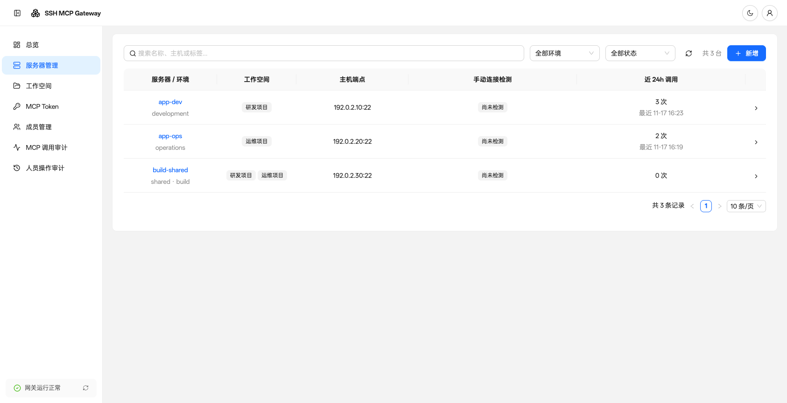
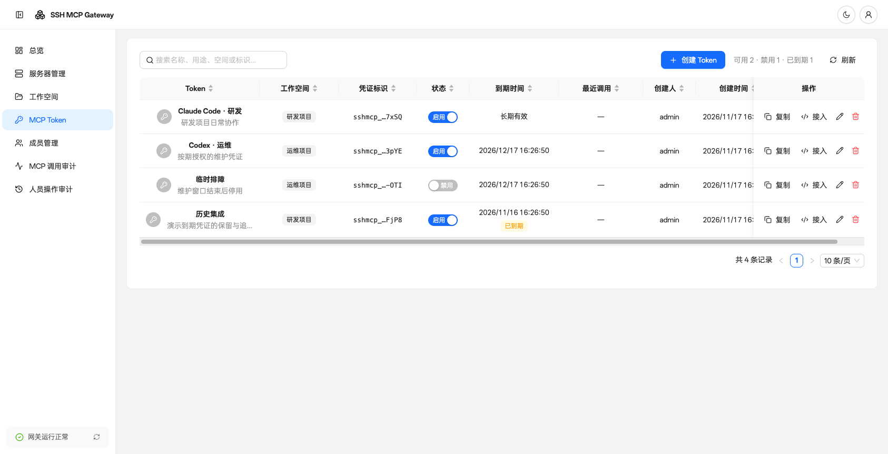
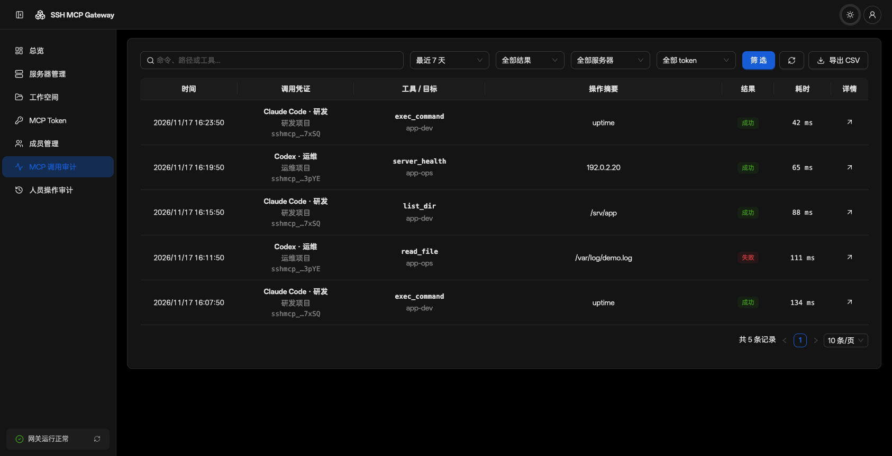

<div align="center">

# SSH MCP

**One workspace for SSH connections, AI tool calls, and operation history.**

[](https://hub.docker.com/r/lijx559/ssh-mcp)
[](docs/releases/2026-10-30-dockerhub.md)
[](https://gofastmcp.com)

[简体中文](README.md) · **English**

[Features](#features) · [Quick start](#quickstart) · [Docker](#deploy) · [MCP setup](#connect) · [Operations](#operations)

</div>

A self-hosted SSH gateway for individuals and teams. Configure Linux hosts once, grant Claude Code, Codex, and other MCP clients access by workspace, and trace both management actions and remote commands, file operations, and host checks.


<sub>Captured from the current build on 2026-11-17. Resources, members, and audit history are isolated demo data, with no production data or credentials. The console UI is in Chinese.</sub>

<a id="features"></a>

## Features

| Capability | Current behavior |
|---|---|
| Resources | Maintain host aliases, accounts, tags, and credentials; saved changes apply without a restart. |
| Workspace access | Assign a resource to multiple projects. Each Token belongs to exactly one workspace and can discover and operate only on its currently assigned resources. |
| MCP tools | 7 tools for commands, directories, text, transfers, and host checks. |
| Token lifecycle | Create, enable, disable, and confirm deletion. Newly issued Tokens support repeat copying plus Claude Code JSON and Codex TOML connection examples. |
| Token expiry | No expiry by default. Set, change, or clear an expiry; expired Tokens reject subsequent calls while preserving identity and history. |
| Members and sessions | Start with admin/admin; ordinary passwords require 6–1024 characters. Enabled members have equal access, the last enabled member is protected, and password changes or disabling/deletion revoke sessions. |
| Two audit trails | Trace management actions and MCP calls by credential, workspace, and actual target. Filters, details, CSV export, and 30-day default retention. |
| Desktop console | Ant Design 6, OPPO Sans 4.0, light/dark themes, a collapsible sidebar, and consistent pagination. |

<details>
<summary>Resources and workspace assignments</summary>



</details>

<details>
<summary>Token copying, controls, and expiry states</summary>



</details>

<details>
<summary>MCP call audit in the dark theme</summary>



</details>

<a id="quickstart"></a>

## Quick start

Requires Python 3.10+ and uv. Built web assets are committed, so starting the service does not require Node.js.

```bash
git clone --branch master https://github.com/Lixiuxiu559/ssh-mcp.git
cd ssh-mcp
uv sync --locked
uv run --locked ssh-mcp --init --config ./runtime/config.yaml
uv run --locked ssh-mcp --config ./runtime/config.yaml
```

CLI options include `--host`, `--port`, `--config`, and `--data-dir`. The latter resolves against the working directory and overrides data paths without moving existing data.

Open **http://127.0.0.1:8808/** and complete the following steps:

1. Sign in with **`admin / admin`** and change the password from the account menu if desired. Ordinary password creation, changes, and resets require **6–1024 characters**; the installation default is the only exception.
2. Create a project in Workspaces.
3. Add resources in Servers and assign one or more workspaces. Store private keys and known_hosts in runtime/keys/ and use keys/... relative paths in configuration.
4. Create a client credential in MCP Token, selecting exactly one workspace. Leave expiry empty for no expiry.
5. Copy the Token from the list or open its connection settings, select Claude Code / Codex, and use the client to discover accessible resources.

The default account is created only when the identity database has no users. Existing users prevent creation or resets. Routine restarts and upgrades preserve users, workspaces, valid Tokens, and expiry settings. Unassigned resources are inaccessible to MCP clients.

### Build Docker from source

Run in the source directory above. This uses a separate local image name; `runtime/` holds all persistent data:

```bash
mkdir -p runtime
umask 077
cat > .env <<EOF
COMPOSE_PROJECT_NAME=ssh-mcp
DOCKER_UID=$(id -u)
DOCKER_GID=$(id -g)
SSHMCP_IMAGE=ssh-mcp:local
SSHMCP_BIND_ADDRESS=127.0.0.1
SSHMCP_PORT=8808
TZ=Asia/Shanghai
EOF
docker compose -f docker-compose.yml -f docker-compose.build.yml build
docker compose -f docker-compose.yml -f docker-compose.build.yml run --rm ssh-mcp ssh-mcp --init --config /data/config.yaml
docker compose -f docker-compose.yml -f docker-compose.build.yml up -d
curl -fsS http://127.0.0.1:8808/healthz
```

`--init` never overwrites an existing configuration; skip it for an existing runtime directory. Stop a source process before starting a container on the same port. When deploying as root, set a dedicated non-root UID/GID in `.env` and give it read/write ownership of `runtime/`.

<a id="deploy"></a>

## Docker Compose: versioned images

This no-checkout option uses the pinned `0.2.0` image. Its features and account setup follow the corresponding [release record](docs/releases/2026-10-30-dockerhub.md). The source build above includes the functionality shown in this README.

Requires Docker Engine (or Docker Desktop) and Docker Compose v2. No source checkout is needed; the image includes the complete web console. The deployment host must be able to reach your SSH hosts.

### 1. Prepare a deployment directory

The following commands target a regular Linux/macOS user. `.env` persists the image, port, and runtime UID/GID for future restarts.

```bash
mkdir -p ssh-mcp/runtime
cd ssh-mcp
umask 077
cat > .env <<EOF
COMPOSE_PROJECT_NAME=ssh-mcp
DOCKER_UID=$(id -u)
DOCKER_GID=$(id -g)
SSHMCP_IMAGE=lijx559/ssh-mcp:0.2.0
SSHMCP_BIND_ADDRESS=127.0.0.1
SSHMCP_PORT=8808
TZ=Asia/Shanghai
EOF
```

For deployment as root, set `DOCKER_UID` / `DOCKER_GID` in `.env` to a dedicated non-root account and give that account ownership of `runtime/`, for example `chown -R 1000:1000 runtime`. The image defaults to UID/GID `1000:1000`.

### 2. Save `docker-compose.yml`

```yaml
name: ssh-mcp
services:
  ssh-mcp:
    image: ${SSHMCP_IMAGE:-lijx559/ssh-mcp:0.2.0}
    restart: unless-stopped
    user: "${DOCKER_UID:-1000}:${DOCKER_GID:-1000}"
    ports:
      - "${SSHMCP_BIND_ADDRESS:-127.0.0.1}:${SSHMCP_PORT:-8808}:8808"
    volumes:
      - ./runtime:/data
    env_file:
      - .env
    environment:
      TZ: ${TZ:-Asia/Shanghai}
    stop_grace_period: 20s
```

Versioned tags and `latest` support **`linux/amd64` / `linux/arm64`**, selected automatically by Docker. Prefer a fixed version for deployments. You can also download [docker-compose.yml](docker-compose.yml) and [.env.example](.env.example) from this repository.

### 3. Initialize and start

```bash
docker compose pull
docker compose run --rm ssh-mcp ssh-mcp --init --config /data/config.yaml
docker compose up -d
docker compose ps
curl -fsS http://127.0.0.1:8808/healthz
```

Run `--init` only for the first deployment: it creates an empty configuration and never overwrites an existing file. Skip initialization when upgrading. Once health returns `{"ok":true}`, open **http://127.0.0.1:8808/**.

### 4. Complete setup for that image version

Follow the first-account setup instructions in the pinned image's console and startup logs, then configure resources and create a client-specific MCP Token. Source-built installations start with `admin / admin` when the identity database has no users.

### Compose configuration

| Setting | Default | Purpose |
|---|---|---|
| `COMPOSE_PROJECT_NAME` | `ssh-mcp` | Use distinct project names, host ports, and runtime directories for multiple deployments. |
| `SSHMCP_IMAGE` | `lijx559/ssh-mcp:0.2.0` | Pinned image; change explicitly when upgrading. |
| `SSHMCP_BIND_ADDRESS` | `127.0.0.1` | Local access only; use `0.0.0.0` when direct LAN access is required. |
| `SSHMCP_PORT` | `8808` | Host port; the container continues to use `8808`. |
| `DOCKER_UID` / `DOCKER_GID` | `1000` / `1000` | Must have read/write access to `runtime/`. |
| `./runtime:/data` | Directory mount | Persists configuration, identities, tokens, and audit; mount the whole directory. |
| `env_file: .env` | `.env` | Supplies resource credentials to the container and values for Compose interpolation. |
| `TZ` | `Asia/Shanghai` | Container timezone; audit timestamps are stored in UTC. |

See [config.example.yaml](config.example.yaml). The live configuration is `runtime/config.yaml`; relative configuration paths resolve against its parent directory. `${VARIABLE}` reads the **container environment** and fails if missing. Add resource credentials to `.env`; web passwords and MCP tokens belong in their respective console pages. Web edits preserve environment references but discard YAML comments.

Inside a container, `127.0.0.1` refers to that container. For resources on the host, Docker Desktop supports `host.docker.internal`; Linux deployments can add `extra_hosts: ["host.docker.internal:host-gateway"]` when appropriate. Use a container-reachable address for remote resources.

<a id="connect"></a>

## Connect an MCP client

Create an MCP Token for the target workspace. Copy it again from the list or open its connection settings for Claude Code JSON / Codex TOML. These examples assume a local client:

Claude Code uses the project's `.mcp.json` file.

```json
{
  "mcpServers": {
    "ssh-mcp": {
      "type": "http",
      "url": "http://127.0.0.1:8808/mcp",
      "headers": {"Authorization": "Bearer <MCP_TOKEN>"}
    }
  }
}
```

Codex uses `~/.codex/config.toml` or a trusted project's `.codex/config.toml`.

```toml
[mcp_servers.ssh-mcp]
url = "http://127.0.0.1:8808/mcp"
http_headers = { Authorization = "Bearer <MCP_TOKEN>" }
```

This example assumes the client and gateway run on the same machine. Remote clients should use the gateway's actual HTTPS URL. Users of an existing deployment do not need a separate gateway process. Call `list_servers` first to discover resource names.

| Tool | Purpose |
|---|---|
| `list_servers` / `server_health` | Discover hosts and check host health. |
| `exec_command` | Run commands with timeouts and output limits. |
| `list_dir` / `read_file` | Browse directories and read UTF-8 text. |
| `upload_file` / `download_file` | Transfer files within configured size limits. |

Defaults: 2 MiB uploads, 10 MiB downloads, 1 MiB text reads, and 64 KiB each for command stdout/stderr. The remote SSH account determines actual permissions. Host keys are not verified unless `known_hosts` is configured. Timeouts do not guarantee termination of detached processes, and connection retries cannot guarantee exactly-once execution.

## People, credentials, and audit

- Web access uses username/password, HttpOnly session cookies, and CSRF protection. All enabled users have equal management access.
- The member list supports direct enable/disable controls and confirmed deletion. The last enabled account cannot be disabled or deleted. Deleting an account revokes its web sessions while preserving audit history and MCP tokens it created.
- The console manages all workspaces and resources. Each SSH device is created once and can belong to multiple workspaces. Unassigned resources are inaccessible to MCP tokens. A token belongs to exactly one workspace, fixed at creation. Removing a resource assignment blocks subsequent calls from that workspace, including established MCP sessions.
- A workspace with assigned resources or undeleted tokens, including disabled tokens, cannot be deleted. Changes to shared connection settings affect every workspace using the resource.
- MCP tokens are separate from users. Newly issued Tokens support copying from the list and generating Claude Code or Codex connection settings. Tokens are stored as verification hashes plus encrypted copies; ordinary list responses expose metadata only. Older hash-only tokens cannot be recovered and must be recreated to enable copying. Tokens authorize `/mcp`, not web login.
- Token creation and editing support an optional expiry in the browser time zone. Leave it empty for no expiry, or explicitly clear an existing limit. Expired Tokens reject subsequent MCP requests and calls, including new attempts after connection waits and retries. Staff may still copy or adjust the expiry; copying never restores access. Restarts preserve the limit, and deleted Tokens cannot be revived.
- Usernames, display names, and Token names allow up to 128 Unicode characters; Token descriptions allow up to 1000. Sign-in and editing share these limits.
- Restarts, upgrades, and container replacement preserve valid tokens. Creating a token or disabling its creator does not delete other tokens. Disabled tokens can be enabled again. Deleted tokens are invalidated immediately and removed from management lists while historical audit records remain available. Password changes and user disabling revoke that user's web sessions.
- Management audit records logins and configuration changes. MCP audit records token identity, actual host/port/remote account and command or path, outcome, and duration. Retention defaults to 30 days, with filters, details, and CSV export.
- Audit excludes credentials and complete file contents. Commands may contain business data; redaction of recognized credentials cannot detect every business secret. Local SQLite audit is neither tamper-proof nor a cross-system transaction guarantee.

<a id="operations"></a>

## Operations and upgrades

### Persistent data

| Host path | Contents |
|---|---|
| `runtime/config.yaml` | Service and resource configuration. |
| `runtime/data/service.token.key` | Persistent encryption key for token copying; back up and restore with the identity database. |
| `runtime/data/service.db` | Users, sessions, workspaces, token assignments, verification hashes, and encrypted copies. |
| `runtime/audit/audit.db` | Management and MCP audit records. |
| `runtime/keys/` | Uploaded private keys, known_hosts, and other SSH files. |

Keep these files, `.env`, and `backups/` out of Git. Preserve the entire `runtime/` directory across upgrades and container replacement.

```bash
docker compose logs -f --tail=100
docker compose restart
docker compose down
```

`down` removes containers without deleting the host `runtime/` directory. Stopping the service interrupts active calls.

### Back up and update

Stop the service before backing up the full directory, including SQLite WAL/SHM files and `data/service.token.key`, or use a reliable SQLite online backup procedure and preserve the matching encryption key. A missing or damaged key blocks copying and new token issuance without changing existing hash authentication. On restoration, the service tightens key-file permissions to `0600`; preserve a regular file and correct ownership.

```bash
mkdir -p backups
docker compose stop
(umask 077; tar -czf "backups/runtime-$(date +%Y%m%d-%H%M%S).tar.gz" runtime .env docker-compose.yml)
docker compose start
```

For a source-built image, update the source and repeat the earlier `build` and `up -d` steps, preserving `.env` and `runtime/`. The pull commands below apply to published images.

Set `SSHMCP_IMAGE` in `.env` to the new published version, then run:

```bash
docker compose pull
docker compose up -d
docker compose ps
```

Workspace access is designed for a fresh deployment. After initialization, create workspaces, assign resources, and issue tokens in the console. Legacy `auth.users` credentials are not imported automatically, and tokens without a workspace cannot call MCP. Routine restarts and upgrades preserve workspaces and valid credentials. Historical audit attribution is retained. Backups and rollback still require matching configuration and data.

### HTTPS and reverse proxy

The default host binding is local, suitable for an HTTPS reverse proxy. Example subpath configuration:

```nginx
location /ssh-mcp/ {
    proxy_pass http://127.0.0.1:8808/;
    proxy_http_version 1.1;
    proxy_buffering off;
    proxy_read_timeout 600s;
}
```

Set `auth.cookie_secure: true` and `auth.cookie_path: /ssh-mcp/` in `runtime/config.yaml`, restart, and use `https://mcp.example.com/ssh-mcp/` with MCP at `.../ssh-mcp/mcp`. The trailing slash in `proxy_pass` strips the prefix. Assets and API calls use relative URLs.

### Troubleshooting

| Symptom | Action |
|---|---|
| Configuration or SQLite is not writable | Match `.env` UID/GID to the owner of `runtime/`; keep the whole directory writable. |
| Remote browsers cannot open the console | Default binding is local; use HTTPS proxying, an SSH tunnel, or an explicit network binding. |
| Web login works but MCP authentication fails | Web accounts and MCP tokens are separate; create a token in the MCP Token page. |
| Resources are unreachable from the container | Check networking, target addresses, and firewalls; avoid accidentally targeting the container's own loopback. |
| How to sign in after installation | Source-built installations use `admin / admin` if no users exist. Existing users retain their credentials; pinned images follow their version-specific setup instructions. |

## Other installation options

Source, Docker, and Python packages share the full HTTP MCP service and console. The following builds a local package from the current source.

<details>
<summary>Python package / uvx</summary>

```bash
uv build
uvx --from ./dist/ssh_mcp-0.2.0-py3-none-any.whl ssh-mcp --init --config /absolute/path/ssh-mcp/config.yaml
uvx --from ./dist/ssh_mcp-0.2.0-py3-none-any.whl ssh-mcp --config /absolute/path/ssh-mcp/config.yaml
```

wheel/sdist includes default configuration and web assets. Local wheels can also be installed with `uv tool install`. Only Docker images are currently published; this does not claim a PyPI package or GitHub Release exists. uvx does not use the source `uv.lock`; prefer a pinned image or source lockfile for production reproducibility. Keep runtime data outside installation caches.

</details>

<a id="development"></a>

## Development and project

The console follows the **Ant Design 6 console specification** with React 19, TypeScript, Vite, OPPO Sans 4.0, native light/dark themes, and consistent table pagination. Components and fonts are held within this service with no parent or sibling runtime imports. See the [development guide](CLAUDE.md).

This product uses OPPO Sans 4.0. Copyright 2024 Guangdong OPPO Mobile Telecommunications Corp., Ltd. See the [OPPO Sans Fonts License Agreement](webui/public/assets/fonts/OPPO-Sans-LICENSE.txt).

```bash
uv sync --locked
uv run --locked pytest
uv run --locked ruff check src tests
cd webui
npm ci
npm run build
```

Rebuild static assets after changing the frontend. To build a container from source, run from the repository root:

```bash
docker compose -f docker-compose.yml -f docker-compose.build.yml up -d --build
```

[Development guide](CLAUDE.md) · [Published digests](docs/releases/2026-10-30-dockerhub.md) · [Report an issue](https://github.com/Lixiuxiu559/ssh-mcp/issues)

This service is independently developed, released, and deployed. It shares conventions with the [MCP workspace](https://github.com/Lixiuxiu559/mcp) and has no runtime dependency on a parent directory or another MCP repository.
