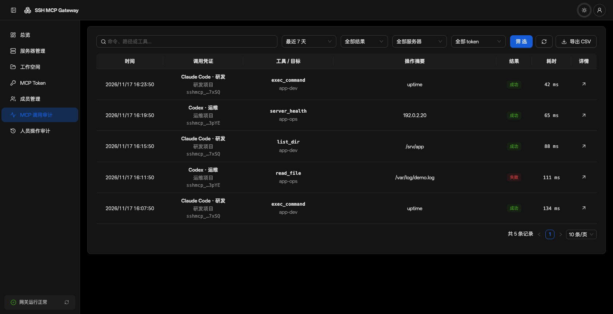

<div align="center">

# SSH MCP

**把服务器连接、AI 工具调用与操作追溯放在一个工作台。**

[](https://hub.docker.com/r/lijx559/ssh-mcp)
[](docs/releases/2026-10-30-dockerhub.md)
[](https://gofastmcp.com)

**简体中文** · [English](README.en.md)

[产品能力](#features) · [快速开始](#quickstart) · [Docker 部署](#deploy) · [MCP 接入](#connect) · [运维](#operations)

</div>

面向个人与团队的自托管 SSH 网关。把 Linux 服务器集中配置一次，按工作空间向 Claude Code、Codex 等 MCP 客户端开放命令、文件和主机检查能力，并追踪人员操作与客户端调用。


<sub>2026-11-17 从当前构建拍摄；资源、成员与审计记录均为隔离演示数据，不含真实业务或凭据。</sub>

<a id="features"></a>

## 产品能力

| 能力 | 当前功能 |
|---|---|
| 资源管理 | 按别名维护主机、账号、标签与凭据，配置保存后热生效。 |
| 工作空间授权 | 一份资源可归属多个项目；每枚 MCP Token 固定属于一个工作空间，只能发现和操作当前归属资源。 |
| MCP 工具 | 7 个工具覆盖命令、目录、文本、文件传输与主机检查。 |
| Token 生命周期 | 独立创建、启停、确认删除；新 Token 支持列表复制及 Claude Code JSON / Codex TOML 接入示例。 |
| Token 到期 | 默认长期有效，可设置、调整或清除到期时间；到期后拒绝后续调用，保留身份和历史。 |
| 成员与会话 | 默认 admin/admin，普通密码 6–1024 字符；人员同权，保护最后一个启用成员，密码变更及停用/删除撤销会话。 |
| 双审计 | 分别查询人员操作与 MCP 调用，按凭证、工作空间和实际目标追溯，支持详情、筛选与 CSV 导出，默认保留 30 天。 |
| 桌面控制台 | Ant Design 6、OPPO Sans 4.0、浅/深主题、可折叠侧栏与统一分页。 |

<details>
<summary>资源与工作空间归属</summary>


</details>

<details>
<summary>Token 复制、启停与到期状态</summary>


</details>

<details>
<summary>MCP 调用审计与深色主题</summary>



</details>

<a id="quickstart"></a>

## Docker 快速部署

需要 Docker Engine 或 Docker Desktop。直接拉取镜像启动，无需 Git、Python、Node.js、`.env` 或预先创建配置文件。下面的 `docker run` 与 Compose 二选一。

```bash
docker pull lijx559/ssh-mcp:0.3.0
docker run -d --name ssh-mcp \
  --restart unless-stopped \
  -p 127.0.0.1:8808:8808 \
  -v ssh-mcp-data:/data \
  lijx559/ssh-mcp:0.3.0
```

打开 **http://127.0.0.1:8808/**，首次登录使用 **`admin / admin`**。镜像会在缺少配置时自动生成默认配置；只有身份库没有用户时才创建默认账号。已有账号、密码、工作空间、Token 与审计不会被重置。

命名卷由 Docker 自动创建，保存 `/data` 下的配置、身份、Token 加密密钥和审计；删除或重建容器不删除该卷。已有部署升级时沿用原来的数据卷或目录挂载、运行 UID/GID 及环境变量设置，只更新镜像，避免切换到空卷。

<a id="deploy"></a>

## 使用 Docker Compose

只需保存下面一个 `compose.yaml` 文件：

```yaml
name: ssh-mcp
services:
  ssh-mcp:
    image: lijx559/ssh-mcp:0.3.0
    container_name: ssh-mcp
    restart: unless-stopped
    ports:
      - "127.0.0.1:8808:8808"
    volumes:
      - runtime:/data
    stop_grace_period: 20s
volumes:
  runtime:
    name: ssh-mcp-data
```

```bash
docker compose pull
docker compose up -d
docker compose ps
```

两种方式使用相同的命名卷和默认容器名，切换前先停止并移除原容器；保留数据卷。不要同时启动两套服务读写同一身份库。

### 登录与资源接入

1. 用 `admin / admin` 登录，可在账号菜单修改密码；普通密码要求 6–1024 个字符。
2. 在「工作空间」创建项目。
3. 在「服务器管理」添加资源，并分配一个或多个所属工作空间。
4. 创建该空间的 MCP Token；到期留空即长期有效。
5. 从 Token 列表复制凭证，或打开「接入」复制 Claude Code / Codex 配置。

默认宿主端口仅允许本机访问。内网直连可把端口映射前面的 `127.0.0.1` 改为 `0.0.0.0`，使用 `http://服务器IP:8808/`；公网接入使用 HTTPS 反向代理。容器中的 `127.0.0.1` 指向容器自身，目标资源应填写容器可达的地址。

镜像默认以 UID/GID `1000:1000` 运行，命名卷无需手动准备目录权限。使用自有宿主目录挂载时，保证该目录可由容器运行用户读写；外部资源凭据可从后台录入。自定义 `${VARIABLE}` 凭据引用时，用 Compose `environment` / 可选 `env_file` 或 `docker run -e` 显式传入。

<a id="connect"></a>

## MCP 接入

先在工作台为目标工作空间创建 MCP Token。可从列表重复复制，或打开「接入」直接复制 Claude Code JSON / Codex TOML；以下是同机接入示例：

Claude Code 在项目目录的 `.mcp.json` 中配置。

```json
{
  "mcpServers": {
    "ssh-mcp": {
      "type": "http",
      "url": "http://127.0.0.1:8808/mcp",
      "headers": {"Authorization": "Bearer <MCP_TOKEN>"}
    }
  }
}
```

Codex 在 `~/.codex/config.toml` 或受信任项目的 `.codex/config.toml` 中配置。

```toml
[mcp_servers.ssh-mcp]
url = "http://127.0.0.1:8808/mcp"
http_headers = { Authorization = "Bearer <MCP_TOKEN>" }
```

上例适用于客户端和服务在同一台机器。远程接入请把 URL 换成网关的实际 HTTPS 地址；已有网关的用户无需再启动一份服务。使用 token 后可先调用 `list_servers` 获取资源名称。

| 工具 | 用途 |
|---|---|
| `list_servers` / `server_health` | 列出服务器、检查主机状态。 |
| `exec_command` | 执行远程命令，支持超时与输出截断。 |
| `list_dir` / `read_file` | 浏览目录、读取 UTF-8 文本。 |
| `upload_file` / `download_file` | 有大小上限的文件传输。 |

默认上限：上传 2 MiB、下载 10 MiB、文本读取 1 MiB、命令 stdout/stderr 各 64 KiB。SSH 实际权限由远端账号决定；未配置 `known_hosts` 时不校验主机指纹，需要校验时挂载相应文件。命令超时不保证结束 `nohup`/`setsid` 子进程，网络重试也不保证远端操作仅发生一次。

## 人员、凭证与审计

- 网页使用用户名/密码、HttpOnly Cookie 会话与 CSRF 校验；所有启用人员同权。
- 成员列表支持直接启用/禁用和确认删除；最后一个启用账号不可禁用或删除。删除账号会撤销其网页会话，保留历史审计及其创建的 MCP token。
- 后台统一管理全部工作空间和资源。每个 SSH 设备只创建一次，可归属多个项目；留空时任何 MCP token 都无法访问。每枚 token 创建时必须单选空间，归属固定。移除资源的项目归属后，该项目已有 MCP 会话的后续调用也会被拒绝。
- 工作空间仍关联资源或未删除的 token（含停用 token）时，删除会被拒绝。修改共享资源的连接配置影响所有使用它的项目。
- MCP Token 与人员账号独立：新建的 Token 支持列表复制，接入提供 Claude Code 与 Codex 两种示例。服务保存验证哈希和加密副本，列表仅返回元数据；原有仅哈希的 token 无法恢复，需新建才能复制。token 仅用于 `/mcp`，不能登录网页。
- Token 创建与编辑可设置到期时间，留空长期有效；时间按浏览器时区输入。到期后停止新的 MCP 请求与调用，人员仍可复制或调整期限；复制不会自动恢复权限。重启与升级保留原期限，已删除 Token 不能复活。
- 用户名、显示名和 Token 名称上限 128 个 Unicode 字符，Token 备注上限 1000 个字符；登录和编辑使用相同边界。
- 重启、升级或重建容器保留有效 token；创建新 token、停用创建者不会自动删除其他 token。禁用后可重新启用；删除后立即失效并从管理列表移除，历史审计保留。密码修改或人员停用会撤销该人员会话。
- 人员审计记录登录与配置变更；MCP 审计记录 token、实际主机/端口/远端账号及命令或路径、结果和耗时。默认保留 30 天，可筛选、查看详情与导出 CSV。
- 审计不保存凭据或完整文件正文。命令可能包含业务数据，已识别凭据脱敏不能识别任意业务秘密。SQLite 审计不提供防篡改或跨系统事务保证。

<a id="operations"></a>

## 运维与升级

默认持久化卷为 **`ssh-mcp-data`**，挂载到容器的 `/data`：

| 容器内路径 | 内容 |
|---|---|
| `/data/config.yaml` | 服务与资源配置。 |
| `/data/data/service.db` | 人员、会话、工作空间、Token 与加密副本。 |
| `/data/data/service.token.key` | Token 加密密钥，必须随身份数据库一起备份和恢复。 |
| `/data/audit/audit.db` | 人员操作与 MCP 调用审计。 |
| `/data/keys/` | SSH 私钥与 known_hosts 等文件。 |

```bash
docker logs -f --tail=100 ssh-mcp
docker restart ssh-mcp
curl -fsS http://127.0.0.1:8808/healthz
```

使用 Compose 时，对应命令是 `docker compose logs -f --tail=100`、`docker compose restart` 和 `docker compose stop`。`docker compose down` 保留命名卷；`down -v` 会删除数据，不用于正常升级。

### 备份与更新

停止容器后可将完整数据目录复制到宿主机，连同 SQLite 文件和 Token 密钥一起备份：

```bash
umask 077
docker stop ssh-mcp
docker cp ssh-mcp:/data "./backup-ssh-mcp-$(date +%Y%m%d-%H%M%S)"
docker start ssh-mcp
```

Compose 更新时，把 `compose.yaml` 的 `image` 改为新版本，再执行：

```bash
docker compose pull
docker compose up -d
```

`docker run` 更新时先拉取新版本，再停止并移除原容器，使用原来的端口和 **同一个数据卷** 重新运行。升级和回滚保留匹配的配置、身份库、密钥与审计；不自动迁移旧 `auth.users` 凭证，也不为缺少工作空间的 Token 自动授权。

### 源码与 Python 包

开发或自行构建时使用源码；普通 Docker 部署无需执行下面的命令。

```bash
git clone --branch master https://github.com/Lixiuxiu559/ssh-mcp.git
cd ssh-mcp
uv sync --locked
uv run --locked ssh-mcp --init --config ./runtime/config.yaml
uv run --locked ssh-mcp --config ./runtime/config.yaml
```

CLI 支持 `--config`、`--host`、`--port`、`--data-dir`；容器默认增加 `--init-if-missing`，配置已存在时直接使用，不覆盖。单独运行 `--init` 创建配置后退出。路径相对配置文件目录解析，`--data-dir` 相对启动目录解析且不移动已有数据。

```bash
uv build
uvx --from ./dist/ssh_mcp-0.3.0-py3-none-any.whl ssh-mcp --init --config /absolute/path/ssh-mcp/config.yaml
uvx --from ./dist/ssh_mcp-0.3.0-py3-none-any.whl ssh-mcp --config /absolute/path/ssh-mcp/config.yaml
```

本地 wheel/sdist 包含默认配置与管理页面，运行数据放在安装缓存之外。uvx 不使用源码的 `uv.lock`；包发布状态以发布记录为准。

<a id="development"></a>

## 开发与项目

管理页面采用 **Ant Design 6 控制台规范**：React 19、TypeScript、Vite、OPPO Sans 4.0、原生浅/深主题与统一表格分页。公共组件与字体由本服务独立持有，运行时不依赖工作空间或其他仓库。开发规则见[开发约定](CLAUDE.md)。

本产品使用 OPPO Sans 4.0 字体。Copyright 2024 Guangdong OPPO Mobile Telecommunications Corp., Ltd. 字体授权原文见 [OPPO Sans Fonts License Agreement](webui/public/assets/fonts/OPPO-Sans-LICENSE.txt)。

```bash
uv sync --locked
uv run --locked pytest
uv run --locked ruff check src tests
cd webui
npm ci
npm run build
```

前端改动后必须重建静态产物。需要本地构建容器时，在仓库根目录执行：

```bash
export SSHMCP_IMAGE=ssh-mcp:local
docker compose -f docker-compose.yml -f docker-compose.build.yml up -d --build
```

[开发约定](CLAUDE.md) · [发布摘要](docs/releases/2026-10-30-dockerhub.md) · [反馈问题](https://github.com/Lixiuxiu559/ssh-mcp/issues)

本服务独立开发、发布和部署，与 [MCP 工作空间](https://github.com/Lixiuxiu559/mcp) 共享统一规范，运行时不依赖父目录或其他 MCP 仓库。
