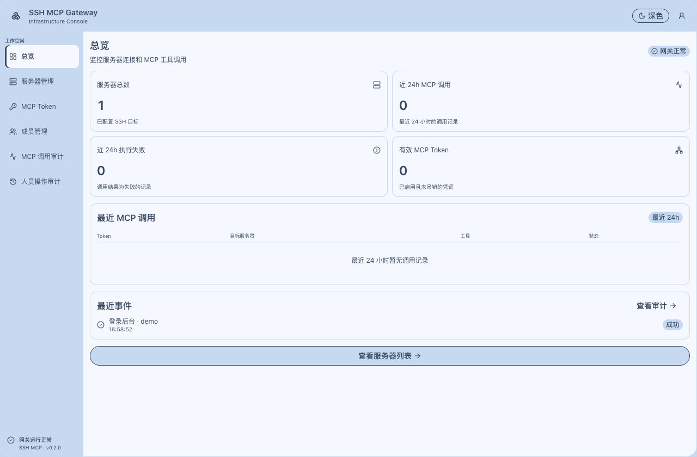
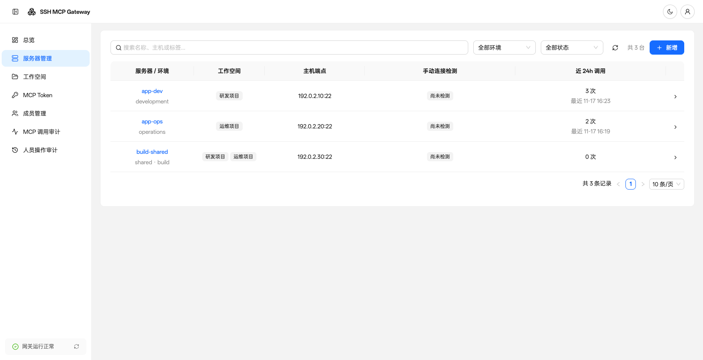
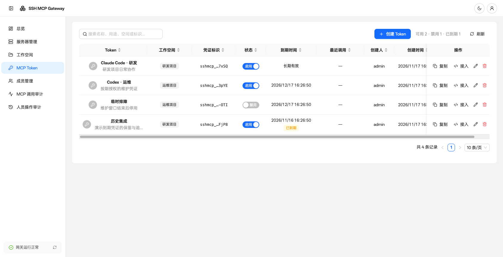

<div align="center">

# SSH MCP

**把服务器连接、AI 工具调用与操作追溯放在一个工作台。**

[](https://hub.docker.com/r/lijx559/ssh-mcp)
[](docs/releases/2026-10-30-dockerhub.md)
[](https://gofastmcp.com)

**简体中文** · [English](README.en.md)

[产品能力](#features) · [快速开始](#quickstart) · [Docker 部署](#deploy) · [MCP 接入](#connect) · [运维](#operations)

</div>

面向个人与团队的自托管 SSH 网关。把 Linux 服务器集中配置一次，按工作空间向 Claude Code、Codex 等 MCP 客户端开放命令、文件和主机检查能力，并追踪人员操作与客户端调用。



<sub>2026-11-17 从当前构建拍摄；资源、成员与审计记录均为隔离演示数据，不含真实业务或凭据。</sub>

<a id="features"></a>

## 产品能力

| 能力 | 当前功能 |
|---|---|
| 资源管理 | 按别名维护主机、账号、标签与凭据，配置保存后热生效。 |
| 工作空间授权 | 一份资源可归属多个项目；每枚 MCP Token 固定属于一个工作空间，只能发现和操作当前归属资源。 |
| MCP 工具 | 7 个工具覆盖命令、目录、文本、文件传输与主机检查。 |
| Token 生命周期 | 独立创建、启停、确认删除；新 Token 支持列表复制及 Claude Code JSON / Codex TOML 接入示例。 |
| Token 到期 | 默认长期有效，可设置、调整或清除到期时间；到期后拒绝后续调用，保留身份和历史。 |
| 成员与会话 | 默认 admin/admin，普通密码 6–1024 字符；人员同权，保护最后一个启用成员，密码变更及停用/删除撤销会话。 |
| 双审计 | 分别查询人员操作与 MCP 调用，按凭证、工作空间和实际目标追溯，支持详情、筛选与 CSV 导出，默认保留 30 天。 |
| 桌面控制台 | Ant Design 6、OPPO Sans 4.0、浅/深主题、可折叠侧栏与统一分页。 |

<details>
<summary>资源与工作空间归属</summary>



</details>

<details>
<summary>Token 复制、启停与到期状态</summary>



</details>

<details>
<summary>MCP 调用审计与深色主题</summary>


</details>

<a id="quickstart"></a>

## 快速开始

需要 Python 3.10+ 和 uv。仓库已包含管理页面构建产物，启动服务无需 Node.js。

```bash
git clone --branch master https://github.com/Lixiuxiu559/ssh-mcp.git
cd ssh-mcp
uv sync --locked
uv run --locked ssh-mcp --init --config ./runtime/config.yaml
uv run --locked ssh-mcp --config ./runtime/config.yaml
```

CLI 支持 `--host`、`--port`、`--config` 与 `--data-dir`。`--data-dir` 相对启动目录解析，只覆盖数据路径，不自动移动已有数据。

打开 **http://127.0.0.1:8808/**，按以下顺序完成接入：

1. 用 **`admin / admin`** 登录，可在账号菜单修改密码。普通新建、修改和重置密码要求 **6–1024 个字符**，安装默认密码是唯一例外。
2. 在「工作空间」创建项目。
3. 在「服务器管理」添加资源并选择一个或多个所属工作空间。私钥与 known_hosts 可放入 runtime/keys/，配置中使用 keys/... 相对路径。
4. 在「MCP Token」为客户端创建凭证，单选一个工作空间；到期时间留空即长期有效。
5. 从列表复制 Token 或打开「接入」，选择 Claude Code / Codex 配置，再用客户端列出可访问资源。

首次启动只在身份库没有任何用户时创建默认账号。已有用户时不补建、不重置；常规重启与升级保留账号、工作空间、有效 Token 和设置的期限。未归属工作空间的资源不向 MCP 客户端开放。

### 用源码构建 Docker

在上面的源码目录中执行。以下使用独立的本地镜像名，`runtime/` 保存全部运行数据：

```bash
mkdir -p runtime
umask 077
cat > .env <<EOF
COMPOSE_PROJECT_NAME=ssh-mcp
DOCKER_UID=$(id -u)
DOCKER_GID=$(id -g)
SSHMCP_IMAGE=ssh-mcp:local
SSHMCP_BIND_ADDRESS=127.0.0.1
SSHMCP_PORT=8808
TZ=Asia/Shanghai
EOF
docker compose -f docker-compose.yml -f docker-compose.build.yml build
docker compose -f docker-compose.yml -f docker-compose.build.yml run --rm ssh-mcp ssh-mcp --init --config /data/config.yaml
docker compose -f docker-compose.yml -f docker-compose.build.yml up -d
curl -fsS http://127.0.0.1:8808/healthz
```

`--init` 不覆盖已有配置；已有运行目录跳过该步。源码进程和容器使用相同端口，运行前先停止另一种启动方式。以 root 部署时，为 `.env` 指定专用非 root UID/GID，并让它拥有 `runtime/` 的读写权限。

<a id="deploy"></a>

## Docker Compose 部署：版本化镜像

以下无需克隆源码，使用固定 `0.2.0` 镜像。镜像功能与账号初始化方式见对应的[发布记录](docs/releases/2026-10-30-dockerhub.md)；上面的源码构建方式包含本文展示的功能。

需要 Docker Engine（或 Docker Desktop）与 Docker Compose v2。无需克隆源码，镜像已包含完整管理页面。部署机器需要能访问目标 SSH 服务器。

### 1. 准备部署目录

以下命令适用于 Linux/macOS 普通用户。`.env` 会保存端口、镜像和运行 UID/GID；后续重启继续使用相同配置。

```bash
mkdir -p ssh-mcp/runtime
cd ssh-mcp
umask 077
cat > .env <<EOF
COMPOSE_PROJECT_NAME=ssh-mcp
DOCKER_UID=$(id -u)
DOCKER_GID=$(id -g)
SSHMCP_IMAGE=lijx559/ssh-mcp:0.2.0
SSHMCP_BIND_ADDRESS=127.0.0.1
SSHMCP_PORT=8808
TZ=Asia/Shanghai
EOF
```

若以 root 部署，在 `.env` 中把 `DOCKER_UID` / `DOCKER_GID` 设为专用非 root 账号的 UID/GID，并将 `runtime/` 属主调整为相同值，例如 `chown -R 1000:1000 runtime`。镜像默认使用 UID/GID `1000:1000`。

### 2. 保存 `docker-compose.yml`

```yaml
name: ssh-mcp
services:
  ssh-mcp:
    image: ${SSHMCP_IMAGE:-lijx559/ssh-mcp:0.2.0}
    restart: unless-stopped
    user: "${DOCKER_UID:-1000}:${DOCKER_GID:-1000}"
    ports:
      - "${SSHMCP_BIND_ADDRESS:-127.0.0.1}:${SSHMCP_PORT:-8808}:8808"
    volumes:
      - ./runtime:/data
    env_file:
      - .env
    environment:
      TZ: ${TZ:-Asia/Shanghai}
    stop_grace_period: 20s
```

固定版本与 `latest` 均支持 **`linux/amd64` / `linux/arm64`**，Docker 自动选择架构。建议部署使用固定版本。也可直接下载本仓库的 [docker-compose.yml](docker-compose.yml) 与 [.env.example](.env.example)。

### 3. 初始化并启动

```bash
docker compose pull
docker compose run --rm ssh-mcp ssh-mcp --init --config /data/config.yaml
docker compose up -d
docker compose ps
curl -fsS http://127.0.0.1:8808/healthz
```

`--init` 仅首次创建空配置，不覆盖已有文件；已有部署升级时跳过初始化命令。健康接口返回 `{"ok":true}` 后，打开 **http://127.0.0.1:8808/**。

### 4. 完成镜像对应的账号初始化

按该固定版本管理页和启动日志的提示完成首次账号设置，再在后台配置资源并创建客户端专用 MCP Token。源码构建版本首次启动、身份库没有用户时，使用 `admin / admin` 登录。

### Compose 配置说明

| 配置 | 默认值 | 说明 |
|---|---|---|
| `COMPOSE_PROJECT_NAME` | `ssh-mcp` | 同机多套部署使用不同项目名、宿主端口与运行目录。 |
| `SSHMCP_IMAGE` | `lijx559/ssh-mcp:0.2.0` | 固定镜像版本，升级时显式修改。 |
| `SSHMCP_BIND_ADDRESS` | `127.0.0.1` | 默认仅本机可访问；需要局域网直连时改为 `0.0.0.0`。 |
| `SSHMCP_PORT` | `8808` | 宿主端口；容器内端口仍为 `8808`。 |
| `DOCKER_UID` / `DOCKER_GID` | `1000` / `1000` | 必须对 `runtime/` 有读写权限。 |
| `./runtime:/data` | 目录挂载 | 同时持久化配置、身份、token 与审计，不能改为仅挂载单个配置文件。 |
| `env_file: .env` | `.env` | 将资源凭据注入容器；`.env` 同时参与 Compose 变量替换。 |
| `TZ` | `Asia/Shanghai` | 容器时区；审计时间以 UTC 存储。 |

配置样例见 [config.example.yaml](config.example.yaml)。实际配置为 `runtime/config.yaml`；配置中的相对路径以配置文件目录为基准。`${VARIABLE}` 从**容器环境**读取，缺少变量会报错；凭据可添加到 `.env`，不要把网页密码或 MCP token 写进该文件。网页保存配置保留环境变量引用，但会丢失 YAML 注释。

容器中的 `127.0.0.1` 指向容器自身。目标服务运行在宿主机时，Docker Desktop 可使用 `host.docker.internal`；Linux 可按环境添加 `extra_hosts: ["host.docker.internal:host-gateway"]`。连接远端资源时填写容器可达的地址。

<a id="connect"></a>

## MCP 接入

先在工作台为目标工作空间创建 MCP Token。可从列表重复复制，或打开「接入」直接复制 Claude Code JSON / Codex TOML；以下是同机接入示例：

Claude Code 在项目目录的 `.mcp.json` 中配置。

```json
{
  "mcpServers": {
    "ssh-mcp": {
      "type": "http",
      "url": "http://127.0.0.1:8808/mcp",
      "headers": {"Authorization": "Bearer <MCP_TOKEN>"}
    }
  }
}
```

Codex 在 `~/.codex/config.toml` 或受信任项目的 `.codex/config.toml` 中配置。

```toml
[mcp_servers.ssh-mcp]
url = "http://127.0.0.1:8808/mcp"
http_headers = { Authorization = "Bearer <MCP_TOKEN>" }
```

上例适用于客户端和服务在同一台机器。远程接入请把 URL 换成网关的实际 HTTPS 地址；已有网关的用户无需再启动一份服务。使用 token 后可先调用 `list_servers` 获取资源名称。

| 工具 | 用途 |
|---|---|
| `list_servers` / `server_health` | 列出服务器、检查主机状态。 |
| `exec_command` | 执行远程命令，支持超时与输出截断。 |
| `list_dir` / `read_file` | 浏览目录、读取 UTF-8 文本。 |
| `upload_file` / `download_file` | 有大小上限的文件传输。 |

默认上限：上传 2 MiB、下载 10 MiB、文本读取 1 MiB、命令 stdout/stderr 各 64 KiB。SSH 实际权限由远端账号决定；未配置 `known_hosts` 时不校验主机指纹，需要校验时挂载相应文件。命令超时不保证结束 `nohup`/`setsid` 子进程，网络重试也不保证远端操作仅发生一次。

## 人员、凭证与审计

- 网页使用用户名/密码、HttpOnly Cookie 会话与 CSRF 校验；所有启用人员同权。
- 成员列表支持直接启用/禁用和确认删除；最后一个启用账号不可禁用或删除。删除账号会撤销其网页会话，保留历史审计及其创建的 MCP token。
- 后台统一管理全部工作空间和资源。每个 SSH 设备只创建一次，可归属多个项目；留空时任何 MCP token 都无法访问。每枚 token 创建时必须单选空间，归属固定。移除资源的项目归属后，该项目已有 MCP 会话的后续调用也会被拒绝。
- 工作空间仍关联资源或未删除的 token（含停用 token）时，删除会被拒绝。修改共享资源的连接配置影响所有使用它的项目。
- MCP Token 与人员账号独立：新建的 Token 支持列表复制，接入提供 Claude Code 与 Codex 两种示例。服务保存验证哈希和加密副本，列表仅返回元数据；原有仅哈希的 token 无法恢复，需新建才能复制。token 仅用于 `/mcp`，不能登录网页。
- Token 创建与编辑可设置到期时间，留空长期有效；时间按浏览器时区输入。到期后停止新的 MCP 请求与调用，人员仍可复制或调整期限；复制不会自动恢复权限。重启与升级保留原期限，已删除 Token 不能复活。
- 用户名、显示名和 Token 名称上限 128 个 Unicode 字符，Token 备注上限 1000 个字符；登录和编辑使用相同边界。
- 重启、升级或重建容器保留有效 token；创建新 token、停用创建者不会自动删除其他 token。禁用后可重新启用；删除后立即失效并从管理列表移除，历史审计保留。密码修改或人员停用会撤销该人员会话。
- 人员审计记录登录与配置变更；MCP 审计记录 token、实际主机/端口/远端账号及命令或路径、结果和耗时。默认保留 30 天，可筛选、查看详情与导出 CSV。
- 审计不保存凭据或完整文件正文。命令可能包含业务数据，已识别凭据脱敏不能识别任意业务秘密。SQLite 审计不提供防篡改或跨系统事务保证。

<a id="operations"></a>

## 运维与升级

### 持久化位置

| 宿主路径 | 内容 |
|---|---|
| `runtime/config.yaml` | 服务与资源配置。 |
| `runtime/data/service.token.key` | Token 复制的持久化加密密钥，必须随身份数据库一起备份和恢复。 |
| `runtime/data/service.db` | 人员、会话、工作空间与 token 归属、验证值和加密副本。 |
| `runtime/audit/audit.db` | 人员操作与 MCP 调用审计。 |
| `runtime/keys/` | 上传的私钥、known_hosts 等 SSH 文件。 |

这些文件与 `.env`、`backups/` 均不应提交到 Git；升级或更换容器时保留整个 `runtime/`。

```bash
docker compose logs -f --tail=100
docker compose restart
docker compose down
```

`down` 停止并移除容器，不删除宿主 `runtime/`。停止服务会中断在途调用。

### 备份与更新

先停止服务再备份完整目录，包含 SQLite 的 WAL/SHM 文件与 `data/service.token.key`；使用 SQLite 在线备份时也要保存匹配的加密密钥。密钥丢失或损坏会阻止复制和新签发，已有哈希认证继续独立工作。恢复密钥文件后，服务会将其权限收紧为 `0600`，请保留普通文件及正确属主。

```bash
mkdir -p backups
docker compose stop
(umask 077; tar -czf "backups/runtime-$(date +%Y%m%d-%H%M%S).tar.gz" runtime .env docker-compose.yml)
docker compose start
```

使用源码构建的镜像时，更新源码后重新执行前面的 `build` 与 `up -d`，保留原 `.env` 和 `runtime/`。下面的拉取命令适用于已发布镜像。

修改 `.env` 中的 `SSHMCP_IMAGE` 为已发布的新版本后执行：

```bash
docker compose pull
docker compose up -d
docker compose ps
```

本次工作空间功能按全新部署设计。初始化后在后台创建工作空间、分配资源并签发 token；旧 `auth.users` 凭证不会自动导入，缺少工作空间的 token 无法调用 MCP。常规重启和升级保留工作空间及有效凭证。历史审计保留已有归属，备份与回滚仍需匹配配置和数据。

### HTTPS 与反向代理

默认端口只绑定本机，适合放在 HTTPS 反向代理后。子路径部署示例：

```nginx
location /ssh-mcp/ {
    proxy_pass http://127.0.0.1:8808/;
    proxy_http_version 1.1;
    proxy_buffering off;
    proxy_read_timeout 600s;
}
```

在 `runtime/config.yaml` 中设置 `auth.cookie_secure: true`、`auth.cookie_path: /ssh-mcp/`，重启服务后使用 `https://mcp.example.com/ssh-mcp/` 与对应的 `.../ssh-mcp/mcp`。`proxy_pass` 尾斜杠会剥除前缀；页面资源和 API 使用相对路径。

### 常见问题

| 现象 | 处理 |
|---|---|
| 无法写配置或 SQLite | 检查 `.env` 中 UID/GID 与 `runtime/` 属主；保持整个目录可写。 |
| 远程浏览器无法打开页面 | 默认仅本机监听；使用 HTTPS 反代、SSH 隧道，或显式修改绑定地址。 |
| 网页登录后 MCP 仍认证失败 | 网页账号与 MCP token 分开管理，在 MCP Token 页面创建专用凭证。 |
| 容器连不上资源 | 检查容器网络、目标地址与防火墙，避免误用容器自己的 `127.0.0.1`。 |
| 首次安装如何登录 | 源码构建版本首次启动无用户时使用 `admin / admin`；已有用户使用原凭据，固定镜像按对应版本的初始化提示操作。 |

## 其他启动方式

源码、Docker 与 Python 包共用完整 HTTP MCP 服务及管理页面。下面演示从当前源码构建本地安装包。

<details>
<summary>Python 包 / uvx</summary>

```bash
uv build
uvx --from ./dist/ssh_mcp-0.2.0-py3-none-any.whl ssh-mcp --init --config /absolute/path/ssh-mcp/config.yaml
uvx --from ./dist/ssh_mcp-0.2.0-py3-none-any.whl ssh-mcp --config /absolute/path/ssh-mcp/config.yaml
```

wheel/sdist 包含默认配置和管理页面；也可 `uv tool install` 安装本地 wheel。当前只发布了 Docker 镜像，未宣称 PyPI 包或 GitHub Release 已发布。uvx 不读取源码的 `uv.lock`；生产完整复现优先使用固定镜像或源码锁文件。运行数据放在安装缓存以外的可写目录。

</details>

<a id="development"></a>

## 开发与项目

管理页面采用 **Ant Design 6 控制台规范**：React 19、TypeScript、Vite、OPPO Sans 4.0、原生浅/深主题与统一表格分页。公共组件与字体由本服务独立持有，运行时不依赖工作空间或其他仓库。开发规则见[开发约定](CLAUDE.md)。

本产品使用 OPPO Sans 4.0 字体。Copyright 2024 Guangdong OPPO Mobile Telecommunications Corp., Ltd. 字体授权原文见 [OPPO Sans Fonts License Agreement](webui/public/assets/fonts/OPPO-Sans-LICENSE.txt)。

```bash
uv sync --locked
uv run --locked pytest
uv run --locked ruff check src tests
cd webui
npm ci
npm run build
```

前端改动后必须重建静态产物。需要本地构建容器时，在仓库根目录执行：

```bash
docker compose -f docker-compose.yml -f docker-compose.build.yml up -d --build
```

[开发约定](CLAUDE.md) · [发布摘要](docs/releases/2026-10-30-dockerhub.md) · [反馈问题](https://github.com/Lixiuxiu559/ssh-mcp/issues)

本服务独立开发、发布和部署，与 [MCP 工作空间](https://github.com/Lixiuxiu559/mcp) 共享统一规范，运行时不依赖父目录或其他 MCP 仓库。
